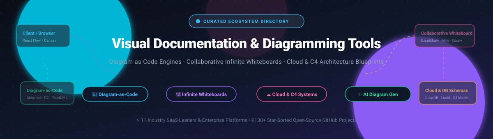
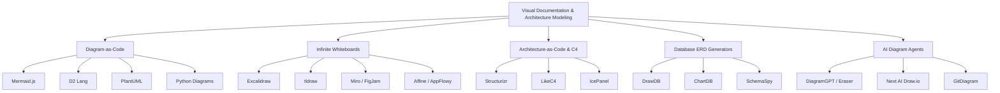

# 📐 Awesome Visual Documentation & Diagramming Tools 🎨

**A definitive, battle-tested curated catalog of visual documentation platforms, diagram-as-code engines, collaborative whiteboards, cloud architecture mappers, and AI-assisted technical specification tools.** 🚀✨

*Last updated: November 2026*

---

## 📑 Table of Contents

- [🌐 Sector Overview & Market Dynamics](#-sector-overview--market-dynamics)
- [☁️ SaaS & Hosted Platforms](#️-saas--hosted-platforms)
- [💻 Open-Source GitHub Projects](#-open-source-github-projects)
- [🎯 Key Diagramming Paradigms](#-key-diagramming-paradigms)
- [📈 Star History](#-star-history)
- [🤝 Support & Sponsorship](#-support--sponsorship)
- [🤝 How to Contribute](#-how-to-contribute)
- [⚖️ Disclaimer](#️-disclaimer)

---

## 🌐 Sector Overview & Market Dynamics

The global visual collaboration and diagramming software market was valued at approximately **$2.8 billion in 2023** and is projected to expand to **over $8.5 billion by 2030**, compounding at a robust **CAGR of ~17.2%**. The sector exhibits a **moderately fragmented market structure**: broad enterprise visual collaboration is fiercely contested by multibillion-dollar incumbents (Figma/FigJam, Miro, Lucid Software), while specialized technical niches—such as developer-centric diagram-as-code pipelines, C4 architecture modeling, database ERD engines, and natural-language AI diagram generators—sustain vibrant, high-growth ecosystems of specialized SaaS startups and viral open-source tooling.

---

## ☁️ SaaS & Hosted Platforms

| Rank | Platform | Valuation / Company Size | Pricing (Starting Tier) | Free Tier Limit / Trial Duration | Key Strengths & Core Capabilities |
| :---: | :--- | :--- | :--- | :--- | :--- |
| 1 | **[Figma FigJam](https://figma.com)** | **$12.5B** valuation (Post-Adobe termination valuation) | **$3 / editor / month** (billed annually for FigJam Starter/Pro) | **Free forever plan**: 3 active FigJam files, unlimited personal drafts, and unlimited collaborators | Real-time collaborative whiteboard canvas deeply embedded with Figma UI/UX components, agile widgets, and technical design flows. |
| 2 | **[Miro](https://miro.com)** | **$17.5B** valuation (Series C, ~$500M+ ARR) | **$8 / member / month** (billed annually for Starter) | **Free forever plan**: 3 editable boards, 2,500+ free templates, core integrations, and unlimited team viewers | Scalable enterprise infinite whiteboard workspace designed for agile ceremonies, cross-functional architecture reviews, and AI diagrams. |
| 3 | **[Lucidchart](https://lucidchart.com)** | **$3.0B+** valuation (Lucid Software, ~$200M+ ARR) | **$7.95 / month** (billed annually for Individual plan) | **Free forever plan**: 3 editable documents, up to 60 objects per document, and 100 professional templates | Intelligent diagramming suite featuring automated AWS/Azure/GCP cloud topology generation, Confluence integrations, and Visio file import. |
| 4 | **[Gliffy](https://gliffy.com)** | **~$50M+** ARR (Sub-division of Perforce Software) | **$8 / user / month** (billed annually for Professional, 1–9 users) | **14-day free trial**: Unrestricted access to all diagramming templates, Confluence/Jira connectors, and export features | Enterprise-grade Atlassian Confluence and Jira native diagramming standard for enterprise architecture, security threat maps, and audit trails. |
| 5 | **[Visual Paradigm Online](https://visual-paradigm.com)** | **~$25M** ARR (Mid-market bootstrapped / independent) | **$4 / user / month** (billed annually for Starter Edition) | **Free forever plan**: Unlimited non-commercial diagrams, 200+ shape types, standard JPG/PNG export with subtle watermark | Comprehensive modeling environment supporting UML 2.x, BPMN 2.0, ArchiMate 3.0, database ERDs, floorplans, and enterprise TOGAF artifacts. |
| 6 | **[Cacoo (Nulab)](https://cacoo.com)** | **~$20M** ARR (Nulab Inc., listed on TSE: 5243) | **$6 / user / month** (billed annually for Pro plan) | **14-day free trial**: Full access to all cloud shape libraries, multi-user live cursors, in-app video chat, and unlimited canvas exports | Multi-user cloud diagramming tool featuring synchronous collaborative cursors, built-in voice/video chat, AWS topology icons, and revision diffs. |
| 7 | **[Whimsical](https://whimsical.com)** | **~$15M** ARR (Venture-backed Series A) | **$10 / editor / month** (billed annually for Pro plan) | **Free forever plan**: Up to 3 collaborative boards, 100 free AI actions, and unlimited team guests/viewers | Blazing-fast diagramming and visual documentation suite combining clean flowcharts, wireframes, mind maps, sequence diagrams, and AI docs. |
| 8 | **[Eraser.io](https://eraser.io)** | **~$10M** valuation (Y Combinator & Stage 2 Capital backed) | **$10 / editor / month** (billed annually for Professional plan) | **Free forever plan**: Up to 3 active files, 5 DiagramGPT AI diagram generations per month, and unlimited viewers | Document-first visual architecture platform tailored for engineering teams; seamlessly alternates between Markdown docs and Diagram-as-Code. |
| 9 | **[Mermaid Chart](https://mermaidchart.com)** | **~$8M** valuation (Seed funded by Open Core Ventures) | **$8 / month** (billed annually for Pro tier) | **Free forever plan**: Up to 5 editable diagrams, Mermaid Live preview, presentation mode, and VS Code / JetBrains sync | The official cloud collaboration platform and Diagram AI assistant designed by Knut Sveidqvist and the core maintainers of Mermaid.js. |
| 10 | **[Terrastruct Cloud](https://terrastruct.com)** | **~$5M** valuation (Angel & Seed funded) | **$20 / user / month** (billed annually for D2 Studio tier) | **14-day free trial**: Complete access to D2 Studio web editor, interactive multi-layer zoom, and auto-layout cloud engines | Advanced software architecture visualization studio built specifically around the open-source D2 declarative diagramming language. |
| 11 | **[IcePanel](https://icepanel.io)** | **~$4M** valuation (Early-stage seed funded) | **$25 / editor / month** (billed annually for Startup plan) | **Free forever plan**: 1 landscape model, up to 3 interactive system maps, community support, and unlimited viewers | Interactive software architecture documentation platform based on the C4 model; links system components to GitHub repositories and cloud services. |

---

## 💻 Open-Source GitHub Projects

*Sorted by GitHub Stargazer Count (Descending). Star count badges link directly to each project's stargazers page.*

| Rank | Repository & Star Badge | Architecture & Core Capabilities | Primary Tech Stack |
| :---: | :--- | :--- | :--- |
| 1 | **[excalidraw/excalidraw](https://github.com/excalidraw/excalidraw)**  | 🎨 Virtual whiteboard with a distinct hand-drawn aesthetic. Features end-to-end encrypted collaboration, Mermaid syntax-to-diagram conversion, shareable canvas links, and embeddable React SDK components. | TypeScript, React, Canvas API |
| 2 | **[mermaid-js/mermaid](https://github.com/mermaid-js/mermaid)**  | 📐 The industry standard in JavaScript diagram-as-code. Compiles Markdown-inspired syntax into dynamic flowcharts, sequence diagrams, Gantt charts, class diagrams, git graphs, and C4 architecture diagrams. | JavaScript, D3.js, Dagre |
| 3 | **[AppFlowy-IO/AppFlowy](https://github.com/AppFlowy-IO/AppFlowy)**  | 📝 Privacy-first, local-first open-source workspace combining rich markdown documentation, Kanban tracking, and interactive visual architecture boards. | Flutter, Rust |
| 4 | **[toeverything/AFFiNE](https://github.com/toeverything/AFFiNE)**  | 🌌 Unified workspace blending structured Notion-style block pages with an unconstrained, infinite edgeless canvas for visual brainstorms and system design. | TypeScript, Rust, React |
| 5 | **[cathrynlavery/diagram-design](https://github.com/cathrynlavery/diagram-design)**  | 🖋️ High-aesthetic editorial diagram design system providing 45+ clean, production-grade diagram blueprints formatted for documentation and LLM coding assistants. | HTML, SVG, Design Specs |
| 6 | **[penpot/penpot](https://github.com/penpot/penpot)**  | 🖌️ Open-source web-based prototyping and diagramming suite built natively on open web standards (SVG, CSS Grid, Flexbox) with full Docker self-hosting support. | ClojureScript, SVG |
| 7 | **[tldraw/tldraw](https://github.com/tldraw/tldraw)**  | ⚡ High-performance infinite canvas SDK and collaborative whiteboard engine powering bespoke diagramming tools, node graphs, and AI visual agents. | TypeScript, React, Canvas |
| 8 | **[logseq/logseq](https://github.com/logseq/logseq)**  | 🧠 Privacy-centric personal knowledge graph featuring native infinite whiteboards to link concept notes, PDF annotations, and software architecture diagrams. | ClojureScript, Electron |
| 9 | **[mingrammer/diagrams](https://github.com/mingrammer/diagrams)**  | 🐍 Diagram as Code for software and cloud architects. Define AWS, Azure, GCP, Kubernetes, and on-premises infrastructure topologies directly in native Python scripts. | Python, Graphviz |
| 10 | **[drawdb-io/drawdb](https://github.com/drawdb-io/drawdb)**  | 🗄️ Intuitive, browser-based database diagram editor and SQL schema builder; visually design relational tables, foreign keys, and export DDL statements instantly. | TypeScript, React |
| 11 | **[xyflow/xyflow](https://github.com/xyflow/xyflow)**  | 🔗 Premier open-source toolkit for building highly customizable node-based UIs, workflow builders, execution trees, and interactive flow diagrams in React and Svelte. | TypeScript, React, Svelte |
| 12 | **[DayuanJiang/next-ai-draw-io](https://github.com/DayuanJiang/next-ai-draw-io)**  | 🤖 Next.js AI diagramming interface connecting LLMs and Model Context Protocol (MCP) servers with Draw.io to generate and update architecture diagrams from natural language. | Next.js, Draw.io, LLM APIs |
| 13 | **[d2lang/d2](https://github.com/d2lang/d2)**  | 📐 Next-generation declarative diagramming language. Turns human-readable plain text into elegant software architecture diagrams using Dagre, ELK, and TALA engines. | Go, WebAssembly |
| 14 | **[chartdb/chartdb](https://github.com/chartdb/chartdb)**  | 📊 Visual database schema designer and ERD modeler. Imports existing database schemas via a single read-only schema query without requiring raw database access credentials. | TypeScript, React, Vite |
| 15 | **[ahmedkhaleel2004/gitdiagram](https://github.com/ahmedkhaleel2004/gitdiagram)**  | 🔍 Turn any GitHub repository into an interactive architecture diagram and codebase tour with zero configuration. | TypeScript, Next.js |
| 16 | **[plait-board/drawnix](https://github.com/plait-board/drawnix)**  | 🎯 All-in-one collaborative whiteboard engine supporting mind mapping, freehand sketching, flowcharting, and bi-directional Mermaid/Markdown parsing. | TypeScript, Plait Framework |
| 17 | **[plantuml/plantuml](https://github.com/plantuml/plantuml)**  | 🏗️ The classic open-source diagram-as-code solution. Converts text declarations into UML sequence, class, use-case, activity, component, deployment, and C4 architecture diagrams. | Java, Graphviz |
| 18 | **[bpmn-io/bpmn-js](https://github.com/bpmn-io/bpmn-js)**  | 🔄 Extensible BPMN 2.0 diagram rendering and web modeling toolkit for embedding live, interactive business workflow diagrams into web applications. | JavaScript, SVG |
| 19 | **[jgraph/drawio](https://github.com/jgraph/drawio)**  | 🌐 Full-featured web and desktop diagramming suite (diagrams.net). Completely private, offline-capable, and equipped with extensive cloud, network, and software modeling shapes. | JavaScript, mxGraph |
| 20 | **[plantuml-stdlib/C4-PlantUML](https://github.com/plantuml-stdlib/C4-PlantUML)**  | 🏛️ C4 model macros and templates for PlantUML, bringing standardized Context, Container, Component, and Deployment diagrams to version-controlled text. | PlantUML, Java |
| 21 | **[mermaid-js/mermaid-live-editor](https://github.com/mermaid-js/mermaid-live-editor)**  | 💻 Official web-based sandbox and interactive environment to edit, preview, render, and share Mermaid diagram specifications. | TypeScript, Svelte |
| 22 | **[likec4/likec4](https://github.com/likec4/likec4)**  | 🔍 Architecture-as-code DSL and interactive React diagram viewer providing multi-level hierarchical drill-down into software architectures. | TypeScript, Langium |
| 23 | **[mermaid-js/mermaid-cli](https://github.com/mermaid-js/mermaid-cli)**  | ⚙️ Command-line utility for Mermaid. Automates headless compilation of Mermaid definitions into SVG, PNG, and PDF artifacts inside CI/CD documentation pipelines. | JavaScript, Puppeteer |
| 24 | **[yuzutech/kroki](https://github.com/yuzutech/kroki)**  | 🚪 Unified multi-format diagram gateway service. Exposes a single HTTP API to convert 25+ textual diagram notations (Mermaid, PlantUML, D2, Graphviz, C4) into SVG/PNG. | Java, Vert.x, Docker |
| 25 | **[ivanceras/svgbob](https://github.com/ivanceras/svgbob)**  | 🔤 Converts raw ASCII art diagrams directly into crisp, scalable SVG vector graphics; ideal for documentation and terminal visualizations. | Rust, WebAssembly |
| 26 | **[schemaspy/schemaspy](https://github.com/schemaspy/schemaspy)**  | 📑 Automated database documentation tool that inspects schema metadata over JDBC and compiles interactive HTML entity-relationship diagrams (ERDs). | Java, Graphviz |
| 27 | **[gaphor/gaphor](https://github.com/gaphor/gaphor)**  | 📐 Clean, approachable desktop modeling suite supporting UML, SysML, RAAML, and C4 model specifications across Windows, macOS, and Linux. | Python, GTK, Cairo |
| 28 | **[structurizr/cli](https://github.com/structurizr/cli)**  | 🏛️ Official command-line utility for the Structurizr C4 software architecture DSL; facilitates workspace export to PlantUML, Mermaid, and interactive web views. | Java |

---

## 🎯 Key Diagramming Paradigms

---

## 📈 Star History

---

## 🤝 Support & Sponsorship

If you found this visual documentation and diagramming tools directory valuable for your engineering workflows, system architectures, or technical writing, please consider supporting the project! 💖

- ⭐ **Star this repository** on GitHub to help more developers and architects discover it.
- 🍴 **Fork and contribute** by adding new tools, frameworks, and benchmarks.
- 📢 **Share with your team**, engineering channels, and social media.
- ☕ **Buy a coffee & sponsor ongoing maintenance** via the [GitHub Sponsor Dashboard](https://github.com/sponsors/ishandutta2007).

---

## 🤝 How to Contribute

We welcome community contributions! To suggest a new visual documentation platform, diagram-as-code engine, or open-source repo:

1. Fork the repository.
2. Verify that the tool aligns with software architecture, diagramming, or visual documentation standards.
3. Ensure pricing and free tier terms are precise and verified.
4. For open-source projects, include the official GitHub repository link.
5. Submit a pull request with a descriptive summary of your proposed changes.

---

## ⚖️ Disclaimer

*All brand names, trademarks, product names, logos, and company registrations referenced in this document belong exclusively to their respective owners. Pricing tiers, feature limits, and star counts are subject to periodic updates by their respective vendors and maintainers.*
